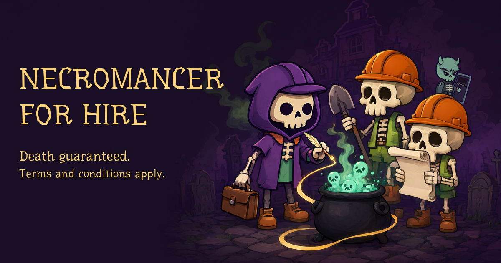
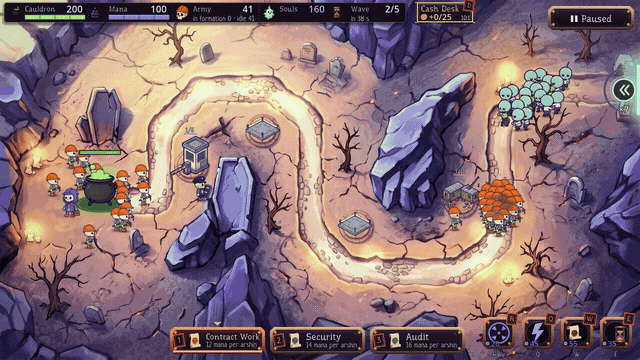
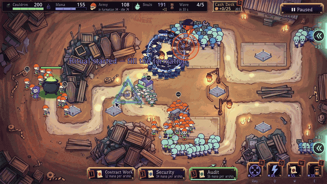
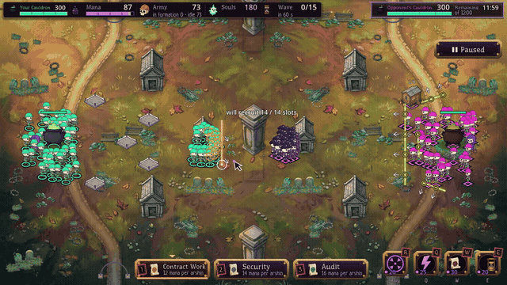
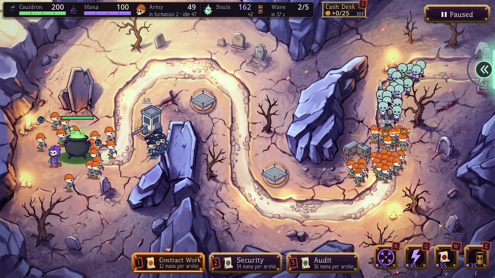
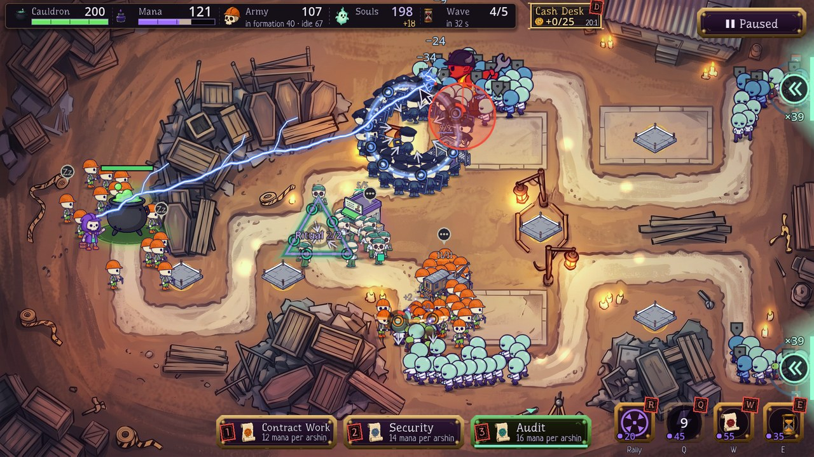
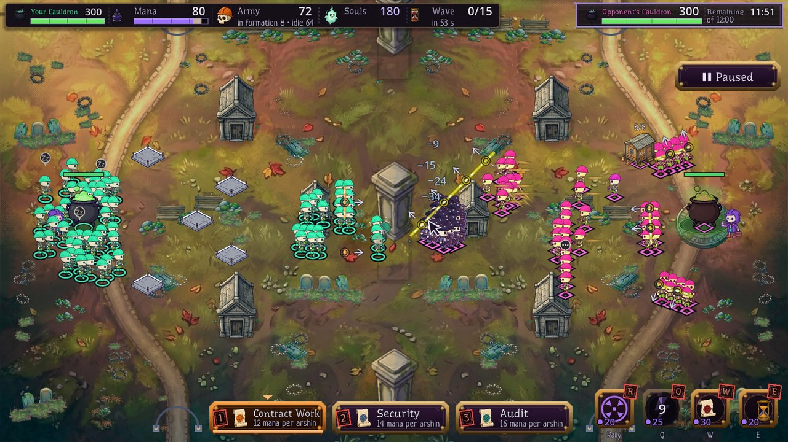
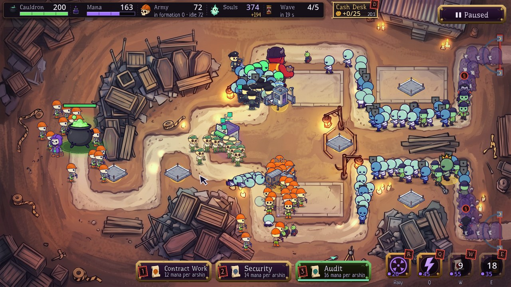

# Necromancer for Hire

English · [Русский](README.md)

**Draw a contract with your mouse. Skeleton contractors form up along it and hold back inspectors from Hell before they reach the Soul Cauldron.** Tower defense, action and roguelike progression in one game. Free for Windows, macOS and Linux. English and Russian. Ages 16+.

Choose the language from the main menu in **Settings → Language / Язык**. The setting covers the interface, tutorials, cutscenes and spoken instructions. You can keep your existing saves when switching languages.

Download: [**Windows**](https://github.com/Pianist13r/necromancer-for-hire/releases/download/0.4.0-alpha/NecromancerForHire-Windows.exe) ·
[macOS](https://github.com/Pianist13r/necromancer-for-hire/releases/download/0.4.0-alpha/NecromancerForHire-macOS.zip) ·
[Linux](https://github.com/Pianist13r/necromancer-for-hire/releases/download/0.4.0-alpha/NecromancerForHire-Linux.tar.gz) ·
[Game website](https://necromancer-for-hire.ru/en/) · [All releases](https://github.com/Pianist13r/necromancer-for-hire/releases) ·
[itch.io](https://pianist13r.itch.io/necromancer-for-hire) ·
[Telegram news](https://t.me/necromancer_for_hire) · [Community chat](https://t.me/necromancer_for_hire_chat) ·
[Feedback form](https://forms.yandex.ru/u/6ac606b3f47e73002a8eaf4e)

**Alpha version 0.4.0-alpha.** Made with Godot 4.7.2.

| Draw contracts | Cast spells | Skirmish |
|---|---|---|
|  |  |  |
| The line melts segment by segment, issuing troop orders | Chain lightning, raised corpses and Crunch Time | Destroy your opponent's Cauldron first |

Contracts expire in segments: contractors charge, guards move the front, and clerks fire a rolling barrage. Shape is a tactic too: a circle is a **Cordon**, a square is a **Square Formation**, and a triangle is a **Ritual**. Play a campaign on hand-designed maps, an Endless Contract with generated maps, the Daily Challenge, or Skirmish against a bot or another player online.

| | |
|---|---|
|  |  |
|  |  |

Screenshots and silent GIFs are captured from gameplay in the English version.

## What's new in 0.4.0-alpha

**Three roles, three orders.** Contractors still charge. Guards move as a cohesive front and push enemies back; retreating backwards or diagonally keeps their shields facing the original direction. Clerks stay at their posts and fire a directional rolling barrage. Pull distance controls the reach of guard and clerk orders; contractor charges keep their full power.

**The preview explains the order.** See the path and reach before releasing. Walls mark only the blocked firing lanes, leaving neighbouring clear lanes available. The gold perfect-release window is separate from the full path.

**Shapes are easier to complete.** Figure eights and D shapes are recognised more reliably with sparse mouse movements. The pen shows closure, mana, unlock requirements and the expected result. A corrected shape can replace a matching ordinary line; a rejected replacement preserves the previous formation. Staffing and charge are shown separately, and an early release warns that the special effect is not ready. How to Play and hints are updated in English and Russian.

**Alpha limitations.** Some sparse, ambiguous outlines still become ordinary lines, and the Archives tutorial needs more work. Player difficulty and enjoyment still need feedback, particularly on whether orders produce useful results.

**Online compatibility.** Versions before 0.4.0 are incompatible with the new battle behaviour. Both players and the server need 0.4.0. Service availability is checked separately from the release version.

## What's new in 0.3.4-alpha

**English and Russian throughout.** Choose your language in Settings for the interface, tutorials, cutscenes and voice acting. English spoken instructions use your current key bindings and left-handed mouse controls. Existing saves carry over.

**English materials.** The website, player guide and promotional materials are available in English. HUD captions fit both languages.

## What's new in 0.3.3-alpha

**Troops at the edge of the map join a nearby line.** Skeletons at the map edge sometimes ignored a contract drawn beside them and only moved for the next line. A troop now counts as occupied by an enemy only when the enemy is actually in reach, or near its home.

**Reserves no longer march across half the map.** Idle reserves at home automatically fill contract slots only within a reasonable range, slightly farther in Skirmish. Bring troops to a distant line with a contract drawn beside them or with Rally.

**Fewer hitches.** All characters are preloaded, removing the hitch when a new enemy type first appears.

**Shapes are easier to draw.** A hand-drawn pentagon, the Committee, no longer turns into a Cordon. The D-shaped Penalty Clause is recognised much more reliably. Drawing a shape not yet unlocked leaves a line and shows where the shape unlocks beside the pen.

**Amendment cards.** Click anywhere on a card to select it, rather than only its title.

**Left-handed mode.** Settings can swap combat mouse buttons: draw with RMB and slingshot or charge with LMB. Menus still use LMB. A separate option reverses contract selection with the wheel. Hints name your actual buttons.

**Personal records.** Your best result on each map appears on its results screen, map card and the Records tab in the Dossier.

**Skirmish.** Opposing contracts use a different tint. An empty online lobby offers a bot match. Bots have three levels: Intern, Contractor and Foreman. Choose your side and reroll a random field with Another Battlefield; results offer Play Again on a New Battlefield. The lobby shows connection progress and your room code.

**Tutorial.** The slingshot lesson moved from the Foreman to the Archives, immediately after the figure eight.

**Balance.** The Gatehouse costs 50 souls instead of 60 and holds 8 / 12 / 16 staff instead of 6 / 9 / 12.

**Menus and hints.** The menu and results link to the Telegram channel, chat and website. The Notary hint uses a banner; pop-up messages no longer hide behind a plot menu.

**Online compatibility.** The battle simulation changed: 0.3.2 and 0.3.3 cannot play together. Both players must update. The release note dated 11 October 2026 records a Yandex Cloud incident that temporarily interrupted online Skirmish, statistics and comments; that dated note is not a live service-status indicator.

Previous release: 0.3.2-alpha

**Tutorial voice names the key at the right moment.** The current binding, including a remapped one, is spoken inside the instruction rather than after the whole sentence.

**Statistics.** The optional statistics question—version, system, sessions and battle minutes—now appears in the main menu at first launch rather than after the first battle. Later, Esc and closing the prompt save no answer; No, thanks records a refusal. Change your choice in Settings.

**Online.** The battle simulation did not change: 0.3.1 and 0.3.2 are compatible.

Previous release: 0.3.1-alpha

**Lines recruit the troops you can see nearby again.** In 0.3.0, idle troops could fill contract slots from anywhere on the map, pulling squads away from positions you had chosen. Automatic marching now applies only to reserves at home—the Cauldron and your buildings—with closer troops first. Troops elsewhere respond to a contract drawn nearby or Rally. Draft rings show who will join, including reserves marching from home; the caption separates recruits from home and total slots.

**Online.** The simulation changed again. 0.3.0 and 0.3.1 cannot play together; both players must update.

Previous release: 0.3.0-alpha

A substantial update to progression, teaching, sound, visuals, maps and bots. These are historical release notes; later releases refine some of this behaviour.

**Progression explains and preserves rewards.** Try Again after a victory no longer loses an amendment: choose a card, sign it, then prepare at the briefing. Defeat also returns through the briefing with repeated preparation visible. The Dossier became interactive: slots and all 20 amendment/artifact rows open details with labelled benefits and costs. All ten grades explain their next unlocks. How to Play covers progression. Results separate battle and grade rewards and animate the XP bar and counters. Older progress migrates automatically; the separate Office screen is gone.

**Tutorials and bindings.** Hints, lessons, briefings, Dossier, help and amendment cards use current bindings. Tutorial voices also name remapped keys supported by the voice set; unsupported bindings use text so voice and screen do not disagree. Tutorial/help numbers come from the game configuration. Brief hints consistently address the player. Esc or a click skips the introduction. In this release, the optional statistics question moved until after the first battle and gained Later; 0.3.2 subsequently moved it back to the main menu. The beginner recommendation is built into the Intern difficulty button. Controls returned to the pause menu with current bindings, including Cash Desk and sound. Assigning an occupied key offers to swap actions.

**Sound.** New effects cover abilities, Rally, hits, combos, crowd pressure, springs, slingshots, building, upgrades, spawning, warnings and breakthroughs. Interface sounds cover hovering, clicking, grades, signing and purchases. Variation and repetition limits keep repeated sounds from becoming a rattle. Longer music tracks distinguish sites, the final wave, the boss and the menu. Music intensifies towards the last wave, ducks under speech, and uses a limiter for crowded battles.

**Graphics and settings.** Screen Shake, Flashes and World Atmosphere are separately adjustable. Turning off flashes retains danger markers, including red dashed expiring segments. World Atmosphere removes the global tint and vignette. The Soul Cauldron pulses with health and reacts to hits. Softer, darker troop outlines and limited damage flashes improve crowd readability. Cauldron backplates were removed from all eight authored maps; support and light are drawn in-game. Three cutscene images were brought into line with the character designs.

**Controls.** Contract-type cards and Call Wave no longer swallow the next drawing stroke. Scrolling immediately before pressing the wheel does not change type. Grabbing a segment captures its arrow. Drawing along an active line renews it, even across types; Shift draws a new line on top. Empty remnants after a charge fade and no longer occupy the six-contract limit. At the limit, the draft turns grey and the pen shows a hint. Pressing an occupied key twice on the bindings screen swaps the keys.

**Gameplay.** Home reserves automatically move to nearby empty contracts of their type. Rally and slingshot pulling keep troops at the selected position for 25 seconds. Building near a road warns when many recruits will spawn under attack, including in the building menu. Recruitment displays permanent staff increases, respawn intervals and time to the next free replacement. Skirmish bots release squads into the flank of passing columns and bring rear troops forward when a visible threat calls for it.

**Maps and runs.** Failed generated layouts retry deterministically without hanging. The generator has a version saved with the run; continuing an older run warns at the briefing. An old `gen:…` link is rebuilt with the current generator, not a stored old layout. Matching Skirmish fields require matching builds. Daily seeds, attempts and records are separated by generator version. Generated maps gained introductory lighting, ground beneath plots and less repetitive roads.

**Animation.** Walking speed matches foot contact more closely in both directions. Troops have two death variants. Raised temporary staff have a separate rising animation, abilities turn the hero towards the target, and the boss enters its attack pose during the warning.

**Online.** Client and server versions must match. The reserve-marching simulation changed, so 0.2.2 and 0.3.0 cannot play together.

**Steam.** Preparation is underway; no date or store page is announced here. Downloads remain available through this repository, itch.io and RuTracker.

Previous release: 0.2.2-alpha

**Fewer screens between battles.** The separate Office was replaced by preparation rows directly above To Battle: Signing Bonus and Necromancer's Thermos show their prices; click to take or remove them. Previous choices repeat when Bonus and slots allow.

**One Dossier.** Grade, XP, three active amendments, campaign artifacts and the catalogue of 20 cards share one screen, opened from the main or pause menu. The briefing's Active section shows signed amendments and artifacts.

**Select, then sign.** Click a row to select an amendment and see details, then use Sign; double-click signs immediately. Nothing signs itself.

**Clearer rewards and wording.** Grade unlocks and the purposes of Bonus and XP are explained. Lightning has a consistent name, and contract mana cost includes amendments.

**Confirmation windows** match the game's style instead of using the generic system dialog.

## Download and install

You do not need Git or the source code to play. Archives include English and Russian instructions.

| System | Download | Launch |
|---|---|---|
| **Windows 10/11, 64-bit** | [**Single executable**](https://github.com/Pianist13r/necromancer-for-hire/releases/download/0.4.0-alpha/NecromancerForHire-Windows.exe) | Download and run; no installation. It is unsigned. If Windows shows “Windows protected your PC”, and you trust this download, choose More info → Run anyway. |
| Windows archive | [NecromancerForHire-Windows.zip](https://github.com/Pianist13r/necromancer-for-hire/releases/download/0.4.0-alpha/NecromancerForHire-Windows.zip) | Extract the whole archive and run `Necromancer.exe`. Keep `Necromancer.pck` beside it with that exact name. |
| **macOS, Intel 11.0+ / Apple Silicon 13.0+** | [**NecromancerForHire-macOS.zip**](https://github.com/Pianist13r/necromancer-for-hire/releases/download/0.4.0-alpha/NecromancerForHire-macOS.zip) | Double-click the ZIP to extract it with Archive Utility, then move the .app to Applications. It is ad-hoc signed and not notarized by Apple. If you trust it, permit this app through System Settings → Privacy & Security → Open Anyway. |
| **Linux, x86_64** | [**NecromancerForHire-Linux.tar.gz**](https://github.com/Pianist13r/necromancer-for-hire/releases/download/0.4.0-alpha/NecromancerForHire-Linux.tar.gz) | Run `tar -xzf NecromancerForHire-Linux.tar.gz`, then `./Necromancer/Necromancer.x86_64`. |

Windows and Linux require a Vulkan-capable graphics card and driver. The macOS universal build requires Metal-capable graphics. The macOS package has been checked structurally but not run on a physical Mac. Linux launch has been checked headlessly on Ubuntu 24.04; desktop support remains alpha.

Progress and settings are stored separately and survive updates. Keep the paths exactly as shown—the old Russian game name is intentional for compatibility:

- Windows: `%APPDATA%\Godot\app_userdata\Некромант на аутсорсе\`
- macOS: `~/Library/Application Support/Godot/app_userdata/Некромант на аутсорсе/`
- Linux: `~/.local/share/godot/app_userdata/Некромант на аутсорсе/`

To update, open **Settings → About → Releases and updates**, or [Releases](https://github.com/Pianist13r/necromancer-for-hire/releases). Close the game before replacing the executable or extracting the entire new build into a separate folder. On macOS, replace the app in Applications. Do not delete your save folder. Settings → About shows the installed version.

## Online Skirmish

Main menu → **Skirmish → Online**. Enter a name; a new profile has the server address prefilled.

If you played an older version, click **Refresh address**, then **Connect**. A saved address is not replaced automatically. The game reads only the address from the public [server.json](https://raw.githubusercontent.com/Pianist13r/necromancer-for-hire/main/server.json) on this repository's `main` branch. If offline or the file is unavailable, the current address stays unchanged. You may enter an address manually; a local server can use `ws://localhost:port`.

Join another room with Play or open your own. Windows, macOS and Linux can play together. Game and server versions must match; if the lobby reports a different build, update. Optional direct peer-to-peer connections expose connection addresses to the opponent; see [Privacy](PRIVACY.md).

## Default controls

- **Drag LMB:** draw a contract. **Wheel / 1–3:** choose contract type.
- **RMB on a formation:** issue the role's order: infantry charge, guard advance or a stationary clerk barrage. Pull back and release to aim opposite to the pull; pull distance also controls guard and clerk reach. Release in the gold enemy zone for **Perfect!**; a simple click follows the contract arrow.
- **Draw over a line:** renew it. **Shift + draw:** place a new line on top.
- **Hold Space or the wheel:** aim the arrow. **Tab:** erase a section.
- **Q / W / E:** hold to aim an ability, release to cast.
- **R:** Rally at the cursor. **F** (or the default alternate **N**): call the next wave. **D:** Cash Desk in single player.
- **Esc / P:** pause a single-player battle. Online matches continue.

Bindings can be changed in Settings. Left-handed mode swaps combat mouse buttons; menus still use LMB. Hints and supported spoken key fragments follow your bindings. Full help and replayable training are in **How to Play → Tutorial**.

## Bugs, ideas and contributions

At first launch, the game asks whether to share optional statistics: version, OS family, sessions and active battle time. Sharing is off until you agree and can be changed in Settings. It does not send names, saves, screenshots or full game logs. [Privacy](PRIVACY.md) explains the session identifier, recipient, retention and separate online networking.

- Report bugs or ideas through [Issues](https://github.com/Pianist13r/necromancer-for-hire/issues). Include your OS, game version, steps and, if useful, a screenshot. Do not post private logs or personal information.
- For code, art or balance contributions, use a pull request. See [CONTRIBUTING.md](CONTRIBUTING.md) for the process and contributor agreement.

## Support development

Optional donations are welcome through [DonationAlerts](https://www.donationalerts.com/r/pianist13r). The game remains free.

## Run from source

1. Use **Godot 4.7.2**, the standard edition rather than .NET, from [godotengine.org](https://godotengine.org).
2. Open `godot/project.godot`, or run `godot --path godot`. After adding classes, import with `godot --headless --path godot --import`.
3. Before a pull request, run `tools/legion_gate.sh` in Git Bash on Windows. Its final line must be `GATE OK`. Install `gdlint` with `pip install gdtoolkit==4.*` and set the `GODOT` environment variable to your executable, for example `GODOT=/path/to/godot tools/legion_gate.sh`. Use isolated user data for tests (`APPDATA=...` on Windows) and `--mute`.

Some code comments refer to internal development notes, decision IDs beginning D-, issue IDs beginning B-, or `docs/…` files. Those internal notes are not included in the public repository.

## License

The game is **source-available, not open source** in the strict sense. Code uses [PolyForm Noncommercial 1.0.0](LICENSE.md), allowing free noncommercial use. Art, music, voices, texts and characters are [reserved to the author, with stated permissions](ASSETS_LICENSE.md); playing, streaming and making videos are allowed. The name and logo are covered by the [trademark policy](TRADEMARKS.md). See [LICENSING.md](LICENSING.md) and [THIRD_PARTY_NOTICES.md](THIRD_PARTY_NOTICES.md).

© 2026 Igor Andreevich Gubanov (Губанов Игорь Андреевич).
